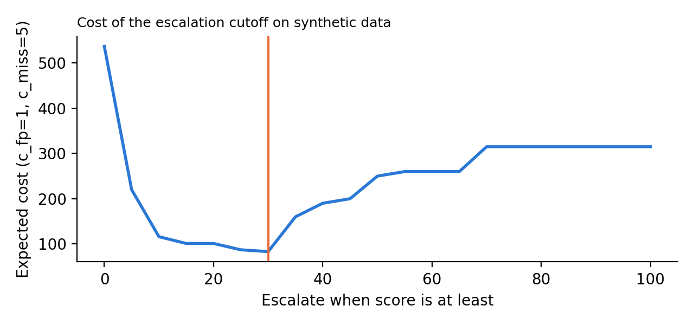

# Registration eligibility triage: a small compliance prototype on synthetic data

A rule-based triage that reads domain registration records, scores each one from 0 to 100, gives plain-language reasons, and recommends one of three actions that mirror a "educate, guide, then enforce" approach to compliance:

| score | action |
|---|---|
| below 10 | no action |
| 10 to 29 | educate and guide (contact the registrant and help them fix it) |
| 30 and above | escalate to a human reviewer |

**This is an independent learning project.** It is not auDA's system, not affiliated with auDA, and the rules are a simplified illustration. They are informed by publicly described eligibility and name-connection ideas (an Australian presence, an entity type that suits the namespace, and a close link between the name and the registrant). The real rules are the current .au Licensing Rules, which differ in detail. **All data is synthetic.** No real registrants, businesses or people are used, and any resemblance is coincidence.

## Why I built it

Whether to flag a record is a decision with costs on both sides. A wrongful flag costs a legitimate small business time and trust. A miss lets an ineligible registration through. I wanted to see how a transparent rule set behaves, where it fails, and how to choose the escalation cutoff from stated costs instead of by feel. The decision rule is the same one I used in an earlier project: act only when the evidence passes `c_fp / (c_fp + c_miss)`.

## What it does

- `data/generate_synthetic.py`: 600 made-up records with hidden ground truth in a separate file, so the rules never see it. About 10% are ineligible. Some ineligible records are deliberately **subtle** (nothing for a rule to catch), and some eligible ones deliberately look **odd** (stale details, a loose name, a pending registration, many domains). The rules should be wrong in both directions.
- `triage/rules.py`: seven rule groups. Each returns a code, points and a reason, so a reviewer sees why a record was flagged.
- `triage/score.py`: sums points (capped at 100) and maps the score to an action.
- `evaluate.py`: compares against the hidden truth, sweeps the escalation cutoff, and picks the one with the lowest expected cost.
- `tests/test_triage.py`: nine tests (each rule on its own, name-matching cases, tier ordering, deterministic generator, truth never leaks into the input file, and that the rules catch most visible cases and, by design, none of the subtle ones).

## Result on the synthetic set (600 records, 63 ineligible)

Assumed costs: a wrongful escalation costs 1, a miss costs 5 (change them in `evaluate.py`).

| | |
|---|---|
| Lowest-cost escalation cutoff | score 30 |
| Escalated | 74 records: 51 correct, 23 wrongful |
| Precision / recall at that cutoff | 69% / 81% |
| Tiers | 493 no action, 33 educate and guide, 74 escalate |
| Caught | every record with an invalid identifier, a cancelled registration, an entity/namespace mismatch, an unrelated name, an unregistered trade mark, or bulk speculative holdings |
| Missed | all 12 subtle cases (by construction) |
| Wrongful escalations | 21 of 23 are the deliberately loose names |



## Limits (read these)

- **The numbers describe this synthetic set, not the real world.** I built the data and the rules, so the high recall on visible cases is close to circular. The useful findings are the shape of the trade-off and the failure cases, not the percentages.
- **The cutoff is tuned on the same data it is scored on** (no held-out set), so it is optimistic.
- **Scores move in steps** (rule points are 8, 10, 20, 30, and so on), so the cutoff cannot land exactly on the theoretical threshold. The share of ineligible records near the chosen cutoff is about 39%, above the 17% implied by the assumed costs, because there is no score between the bands.
- **Subtle cases need other signals** that rules on a single record cannot see (patterns across registrants, complaints, content). This prototype does not attempt that.
- **Rules are not law.** Do not use this to judge any real registration.

## Run it

```
python data/generate_synthetic.py
python evaluate.py
python tests/test_triage.py
```

Or `bash run_all.sh`. Needs Python 3 and matplotlib (for the chart only).
